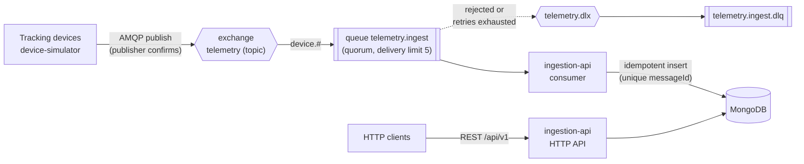

# Wayline

[](https://github.com/amirhoseinhoseinpoor/iot-signal-pipeline/actions/workflows/ci.yml)


**Real-time GPS telemetry ingestion for vehicle fleets.**

Wayline takes position and speed readings from tracking devices, moves them through
a message broker, stores them with per-trip statistics, and serves them over a REST
API. It is built to keep working when parts of the system fail: the broker restarts,
the database is briefly unavailable, or a device sends the same batch twice.



## Features

- **No data loss on crash.** A message is acknowledged only after it is stored; otherwise the broker redelivers it.
- **Exactly-once storage on top of at-least-once delivery.** Each batch carries a `messageId`, backed by a unique index, so replays are recognised and ignored.
- **Poison messages are isolated.** Malformed or invalid batches go straight to a dead-letter queue. Batches that keep failing for transient reasons are retried up to five times and then dead-lettered by the broker.
- **Self-healing connections.** Both services reconnect to RabbitMQ automatically and re-declare their topology.
- **Route statistics at ingest time.** Distance (haversine), duration, and max and average speed are computed per batch.
- **Fleet overview.** `GET /api/v1/devices` returns activity totals and the last known position of every device.
- **Strict validation everywhere.** The same DTOs validate HTTP requests and queue messages, and unknown fields are rejected.
- **Operable.** Liveness and readiness probes, environment validation at startup, graceful shutdown, OpenAPI docs, and multi-stage non-root Docker images.

## Quick start

Requirements: Docker with Compose v2.

```bash
docker compose up --build
```

| What                 | Where                                                           |
| -------------------- | --------------------------------------------------------------- |
| API docs (Swagger)   | http://localhost:3000/docs                                      |
| Fleet overview       | http://localhost:3000/api/v1/devices                            |
| Readiness probe      | http://localhost:3000/health/ready                              |
| RabbitMQ management  | http://localhost:15672 (user `wayline`, password `wayline`)     |

The simulator starts five vehicles around Berlin that each publish a batch every
five seconds. Change `DEVICE_COUNT` or `PUBLISH_INTERVAL_MS` to adjust the load:

```bash
DEVICE_COUNT=50 PUBLISH_INTERVAL_MS=1000 docker compose up --build
```

## Telemetry message

Devices publish to the `telemetry` exchange with routing key `device.<deviceId>`.
The same body is accepted by `POST /api/v1/telemetry`.

```json
{
  "messageId": "3f1c9a4e-8d2b-4c55-9a51-0b7c2e6f1d90",
  "deviceId": "vehicle-001",
  "recordedAt": "2026-11-17T09:30:00.000Z",
  "readings": [
    { "offsetMs": 0,    "lat": 52.520008, "lng": 13.404954, "speedMps": 8.3 },
    { "offsetMs": 1000, "lat": 52.520081, "lng": 13.405012, "speedMps": 8.6 }
  ]
}
```

| Field        | Rules                                                                 |
| ------------ | --------------------------------------------------------------------- |
| `messageId`  | 1 to 128 characters, unique per batch; it is the idempotency key       |
| `deviceId`   | 1 to 64 characters: letters, digits, `.`, `_` or `-`                  |
| `recordedAt` | ISO 8601 timestamp of the first reading                               |
| `readings`   | 1 to 1000 items; `offsetMs` is relative to `recordedAt`               |
| `lat`/`lng`  | Valid WGS84 coordinates                                               |
| `speedMps`   | Ground speed in metres per second, 0 to 150                           |

## REST API

All endpoints are under `/api/v1`. Full schemas are in Swagger at `/docs`.

| Method | Path              | Description                                                                 |
| ------ | ----------------- | --------------------------------------------------------------------------- |
| POST   | `/telemetry`      | Ingest a batch. `201` when new, `200` when the `messageId` was seen before |
| GET    | `/telemetry`      | Paginated list, newest first. Filters: `deviceId`, `from`, `to`, `page`, `limit` |
| GET    | `/telemetry/:id`  | One batch including raw readings                                            |
| DELETE | `/telemetry/:id`  | Delete a batch                                                              |
| GET    | `/devices`        | Per-device totals and last known position                                   |
| GET    | `/health/live`    | Liveness (outside `/api/v1`)                                                |
| GET    | `/health/ready`   | Readiness: `503` unless MongoDB and RabbitMQ are both reachable             |

Telemetry is append-only: batches can be deleted but not edited, because
statistics are derived from the readings.

## Repository layout

```
services/
  ingestion-api/       NestJS: AMQP consumer + REST API + MongoDB
    src/telemetry/     domain logic (route stats), DTOs, schema, service, controllers
    src/messaging/     broker topology, consumer, ack/retry/dead-letter decisions
    src/health/        liveness and readiness probes
    test/              end-to-end tests against an in-memory MongoDB
  device-simulator/    NestJS worker: kinematic vehicle model + publisher
docs/adr/              architecture decision records
```

## Development

Each service is a standalone Node.js project (Node 20 or later).

```bash
cd services/ingestion-api
cp .env.example .env
npm install
npm run start:dev
```

Start MongoDB and RabbitMQ for local development with
`docker compose up mongo rabbitmq`.

| Command              | What it does                                         |
| -------------------- | ---------------------------------------------------- |
| `npm test`           | Unit tests                                           |
| `npm run test:e2e`   | API tests against a real, in-memory MongoDB          |
| `npm run test:cov`   | Unit tests with coverage                             |
| `npm run lint`       | ESLint with type-aware rules and Prettier            |
| `npm run typecheck`  | TypeScript in strict mode                            |

CI runs all of these for both services on every push and pull request, then builds
the Docker images.

## Design decisions

The reasoning behind the main choices is recorded in [`docs/adr`](docs/adr):

1. [Quorum queue with a delivery limit and a dead-letter queue](docs/adr/0001-quorum-queue-and-dead-lettering.md)
2. [Idempotent ingestion keyed on `messageId`](docs/adr/0002-idempotent-ingestion.md)
3. [One telemetry document per batch](docs/adr/0003-batch-per-document.md)

## Roadmap

- [x] Reliable ingestion: dead-lettering, idempotency, reconnects, validation
- [x] Tests and CI
- [ ] MQTT gateway for constrained devices
- [ ] Anomaly detection (GPS jumps, impossible speeds, stale devices)
- [ ] Live updates over WebSocket and a map dashboard
- [ ] Metrics (Prometheus) and dashboards (Grafana)

## License

[MIT](LICENSE)
